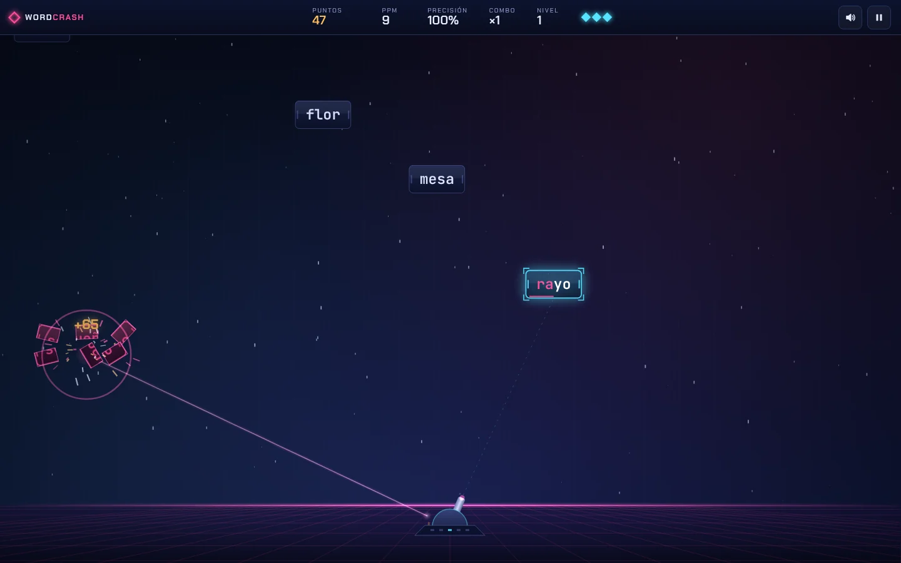
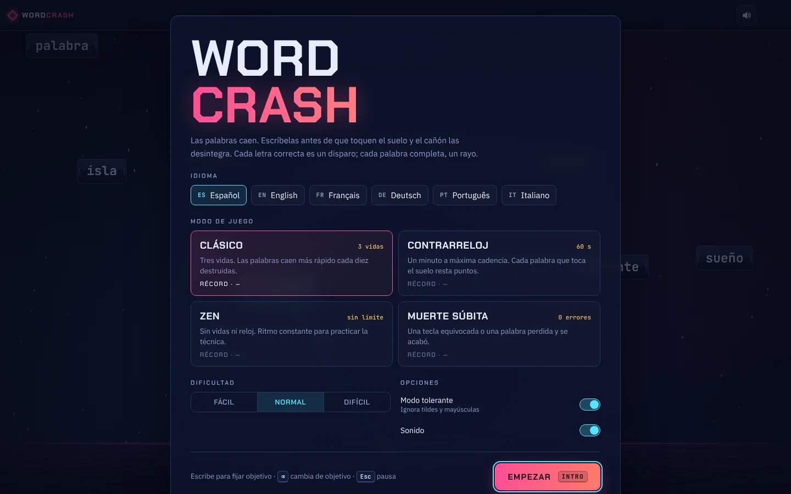

# WordCrash

[](https://github.com/ElCyberCurioso/wordcrash/actions/workflows/deploy.yml)

Juego de mecanografía para el navegador. Las palabras caen desde lo alto; escríbelas antes de que toquen el suelo y un cañón láser las desintegra.

**[▶ Jugar](https://elcybercurioso.github.io/wordcrash/)**



## Características

- **Seis idiomas**: español, inglés, francés, alemán, portugués e italiano.
- **Cuatro modos de juego**: Clásico, Contrarreloj, Zen y Muerte súbita.
- **Tres dificultades**, con récord independiente para cada combinación de modo, idioma y dificultad.
- **Modo tolerante** (activado por defecto): acepta letras sin tilde y en minúscula (`a` vale por `á`, `s` por `ß`, `o` por `Ö`).
- **Estadísticas en vivo**: puntos, pulsaciones por minuto (PPM), precisión, combo y nivel.
- **Efectos**: disparo por cada letra, rayo láser al completar la palabra, fragmentación del bloque, partículas y sonido sintetizado.
- **Sin dependencias**: HTML, CSS y JavaScript nativos (módulos ES). Sin paso de compilación.
- **Funciona sin conexión** una vez visitado (service worker) y se puede instalar como aplicación.
- Respeta `prefers-reduced-motion` y se adapta a móvil con teclado virtual.



## Cómo se juega

Empieza a escribir: la primera letra fija como objetivo la palabra **más cercana al suelo** que empiece por ella. Cada letra correcta dispara al bloque; al completar la palabra, el láser la destruye.

| Tecla | Acción |
|---|---|
| Letras | Fijar objetivo y teclear |
| <kbd>Retroceso</kbd> | Soltar el objetivo actual y elegir otro |
| <kbd>Esc</kbd> | Pausar / reanudar |
| <kbd>Intro</kbd> | Empezar partida (desde el menú o los resultados) |

La partida se pausa sola al cambiar de pestaña o de ventana.

### Modos

| Modo | Regla | Fin de partida |
|---|---|---|
| Clásico | 3 vidas; sube de nivel cada 10 palabras | Al perder las 3 vidas |
| Contrarreloj | 60 segundos; cada palabra perdida resta 50 puntos | Al agotarse el tiempo |
| Zen | Ritmo constante, sin presión | Cuando quieras (pausa → terminar) |
| Muerte súbita | Ni un error | Primera tecla equivocada o palabra perdida |

### Puntuación

```
puntos = letras × 10 × (1 + 0,1 × combo) × (1 + 0,5 × altura)
```

- `combo` cuenta palabras seguidas sin fallar (máximo ×20 en el cálculo).
- `altura` va de 0 (palabra a ras de suelo) a 1 (recién aparecida): destruirlas pronto da hasta un 50 % más.
- **PPM** sigue el estándar de mecanografía: 5 pulsaciones correctas = 1 palabra.

## Ejecutar en local

Los módulos ES no se cargan con `file://`, así que hace falta un servidor estático. Cualquiera vale:

```bash
cd public
python3 -m http.server 8000
# o bien: npx serve .
```

Abre <http://localhost:8000>. El service worker solo se registra bajo HTTPS, así que en local siempre ves los cambios al instante.

## Despliegue en GitHub Pages

El workflow [`.github/workflows/deploy.yml`](.github/workflows/deploy.yml) publica la carpeta `public/` en cada push a `main`.

1. Clona el repositorio, copia dentro el contenido del proyecto (sustituyendo el README inicial si lo hay) y súbelo:

   ```bash
   git clone git@github.com:ElCyberCurioso/wordcrash.git
   cd wordcrash
   # copia aquí .github/, docs/, public/, README.md, LICENSE, .gitignore y .editorconfig
   git add .
   git commit -m "WordCrash v1.0"
   git push origin main
   ```

2. En el repositorio: **Settings → Pages → Build and deployment → Source: GitHub Actions**.
3. Si el primer workflow falló porque Pages aún no estaba activado, ejecútalo de nuevo desde **Actions → Desplegar en GitHub Pages → Run workflow**.

El juego quedará en `https://elcybercurioso.github.io/wordcrash/`. El workflow solo se dispara con la rama `main`; si tu rama por defecto se llama distinto, cámbiala en `deploy.yml`.

> **Si cambias el nombre del repositorio**, sustituye `wordcrash` en las etiquetas `canonical`, `og:url` y `og:image` y en el enlace «Código fuente» de `public/index.html`, y en las URLs de este README. El resto de rutas son relativas y funcionan con cualquier nombre.

## Estructura

```
public/                     ← lo que se publica
├── index.html              estructura, metadatos y política CSP
├── css/styles.css          estilos y @font-face
├── js/
│   ├── main.js             punto de entrada: pantallas, teclado, bucle principal
│   ├── engine.js           lógica: aparición, tecleo, puntuación, niveles, partículas
│   ├── renderer.js         dibujo en canvas (fondo, bloques, torreta, láser)
│   ├── ui.js               HUD, menú y resultados (DOM)
│   ├── audio.js            efectos sintetizados con Web Audio
│   ├── storage.js          ajustes y récords en localStorage
│   ├── config.js           modos, dificultades y constantes ajustables
│   ├── utils.js
│   └── data/
│       ├── languages.js    registro de idiomas
│       └── words/*.js      una lista de palabras por idioma
├── assets/fonts/           Chakra Petch, IBM Plex Sans, JetBrains Mono (woff2)
├── assets/icons/           favicon e iconos de la PWA
├── manifest.webmanifest
└── sw.js                   caché sin conexión (red primero)
docs/img/                   capturas del README (no se publican)
```

## Personalización

### Añadir un idioma

1. Crea `public/js/data/words/xx.js`:

   ```js
   export default ['palabra', 'otra', /* … */];
   ```

2. Regístralo en `public/js/data/languages.js`:

   ```js
   import xx from './words/xx.js';
   // …
   xx: define('Nombre del idioma', xx),
   ```

3. Añade `./js/data/words/xx.js` a `PRECACHE` en `public/sw.js` y sube `VERSION`.

Conviene incluir palabras de 2 a 16 letras: el juego elige la longitud según el nivel. Las fuentes incluidas cubren el alfabeto latino extendido; para otros alfabetos (cirílico, griego…) habría que añadir sus subconjuntos de fuente.

### Ajustar la dificultad

Los modos, las vidas, la duración del contrarreloj y los multiplicadores de velocidad están en `public/js/config.js`. Las curvas de caída y aparición por nivel están en `fallTime()` y `spawnGap()` de `public/js/engine.js`.

## Privacidad y seguridad

- Todo se sirve desde el propio dominio: sin CDNs, sin analítica, sin cookies.
- `index.html` declara una Content Security Policy estricta (`default-src 'self'`, sin `unsafe-inline` ni `unsafe-eval`). GitHub Pages no permite cabeceras HTTP propias, así que la política va en una etiqueta `<meta>`; por esa vía no se puede aplicar `frame-ancestors`.
- Lo único que se guarda son los ajustes y los récords, en el `localStorage` del navegador.

## Créditos y licencia

Código bajo licencia [MIT](LICENSE).

Fuentes bajo [SIL Open Font License 1.1](public/assets/fonts/): [Chakra Petch](https://github.com/m4rc1e/Chakra-Petch), [IBM Plex Sans](https://github.com/IBM/plex) y [JetBrains Mono](https://github.com/JetBrains/JetBrainsMono), obtenidas de [Fontsource](https://fontsource.org).
